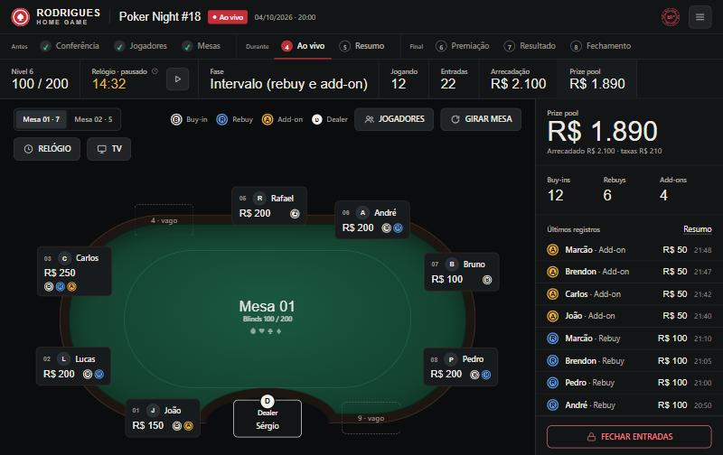
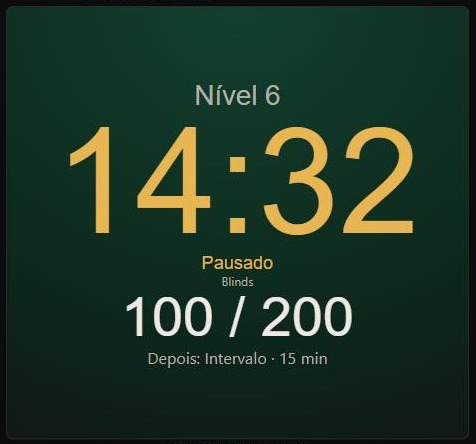
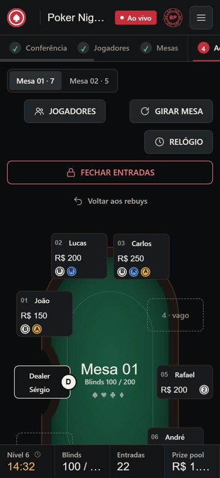
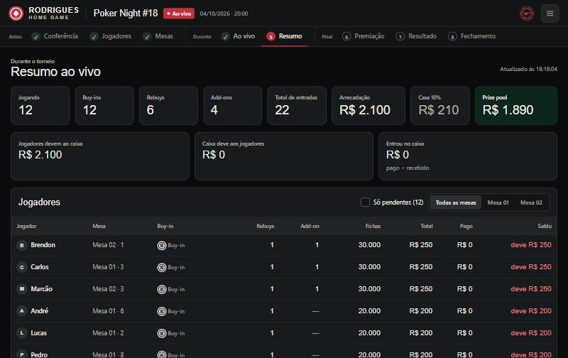

# Rodrigues Home Game

[](https://github.com/BrendonPietro/home-game-manager/actions/workflows/tests.yml)

🇧🇷 [Versão em português](README.md)

Management system for a weekly **in-person** poker home game. It replaces the spreadsheet used on game night: tournaments and cash games, players and tables, buy-ins, rebuys, add-ons and extras, payments, prize pool, payouts, "who pays whom" settlements, rankings and the tournament clock on the TV.

One Laravel app with two entry points:

- **Operations site** (`/`): used at the table during the night, on a laptop, tablet or phone. Table seating, a panel for each player (entry, payment, elimination), tournament phases, summary and closing.
- **Admin panel** (`/painel`): used on the PC to set up games and templates, the list of confirmed players with prepayments, blind structures, rankings, calendar, table rentals, reports and permissions.

## Screenshots

Game night live: table seating, who has paid and what each player bought, with the prize pool updated on the side.

<p align="center"></p>

The tournament clock (sent to the TV through a link with no login) and the same table on a phone:

<p align="center">&nbsp;&nbsp;</p>

The night's financial summary, player by player:

<p align="center"></p>

<sub>Data from the seeded sample night (fictional). The interface is in Portuguese.</sub>

## What it does on game night

1. **Before**: the game is set up in the panel (entries, extras, fees, payouts and blinds), with the list of confirmed players and who has already paid.
2. **At the table**: everyone who sits down enters with the buy-in. Busted players can come back with a rebuy, right away or at the break. Partial or full payments, by Pix or cash, at any time.
3. **The clock**: runs on its own in the browser, even offline, and goes to the TV through a link that needs no login.
4. **Phases**: OPEN BREAK (opens the add-on; rebuys continue) and CLOSE ENTRIES (locks the payouts; every elimination already gets its finishing position).
5. **Closing**: checks collected money, fees, prize pool and payouts, suggests the settlements and records the ranking points.
6. **Corrections**: going back a phase or undoing a payment requires a reason and is kept in the game history (who, what and when).

Amounts are always stored as integer cents and nothing is deleted: undoing only marks the record as cancelled.

## Stack

PHP 8.5, Laravel 13, Filament 5 (panel), Livewire 4 + Alpine.js (site), SCSS with the club's design system, Vite and MySQL. No WebSockets, queues or cron: it runs on shared hosting (live screens use polling).

## Running locally

```bash
composer install
npm install
cp .env.example .env          # set the database and initial passwords (PAINEL_SENHA_INICIAL, SITE_SENHA_INICIAL)
php artisan key:generate
php artisan migrate --seed    # with APP_ENV=local it also creates a sample game night
npm run build                 # or npm run dev
php artisan serve
```

The seeder creates the `dev` panel account and the `dev@rodrigues.test` site account. If no password is set in `.env`, one is generated and printed in the terminal.

## Tests

```bash
php artisan test --parallel
```

The sample night (12 players, 22 entries) is the reference for the math: R$ 2,100 collected, R$ 210 in fees and a R$ 1,890 prize pool, paid out as 950 / 565 / 375. The tests check these numbers through the calculator and by playing the whole night through the Actions.

## Documentation (in Portuguese)

- [docs/arquitetura.md](docs/arquitetura.md): folder structure, routes and screens
- [docs/regras.md](docs/regras.md): game-night rules, calculations, settlements, permissions and the clock
- [docs/painel.md](docs/painel.md): the Filament panel
- [docs/design-system.md](docs/design-system.md): the design system and visual rules
- [docs/deploy.md](docs/deploy.md): local environment, deploy and backup
- [docs/roteiro-de-teste.md](docs/roteiro-de-teste.md): manual test script for the whole system, in game-night order
- [CHANGELOG.md](CHANGELOG.md): what changed in each version
